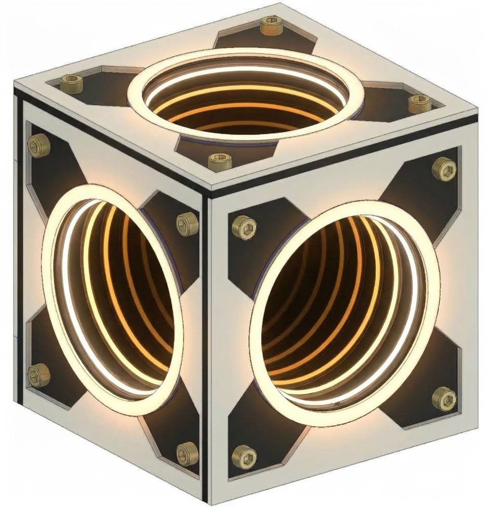

<!-- TOC -->
- [Onderdelen:](#onderdelen)
    - [Geprinte onderdelen:](#geprinte-onderdelen)
- [Voorbereiding:](#voorbereiding)
- [Solderen:](#solderen)
- [Montage:](#montage)
- -
- -
- -
- -
- -
- -
- -
- -
- -
- -
- -
- -
- -
<!-- /TOC -->

# Onderdelen:

## Geprinte onderdelen: 

- 1x achterkant
- 1x voorkant
- 1x bodem
- 1x deksel
- 2x zijkant
- 4x koppel connector 90
- 4x koppel connector 270
- 3x/4x spegel 2way spiegel mount
- 3x/4x spegel spiegel mount

## spiegels:
- 3x/4x 50mm x 1mm spiegel
- 3x/4x 53mm x 2.6mm  way-spiegel

## Montage:
- 16x M3 x 6mm
- 4x M3 x 8mm

## Electronica:
- 3x/4x - 2x xx mm draad
- usb c / micro - usb socket mount
- 3x/4x - xx mm led strip (8mm breed)
  
## Tools:
- 1x M3 Inbus (2.5) 
- 1x Soldeerbout 
- 1x Tin 
- 1x Zijknip tang

---

# 1. Voorbereiding: 

